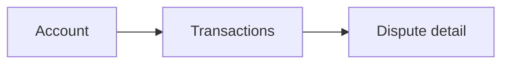
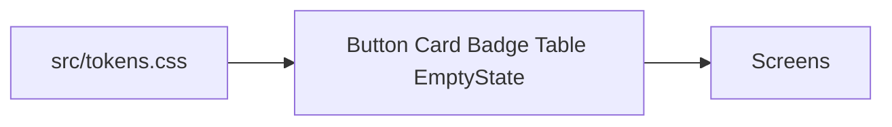
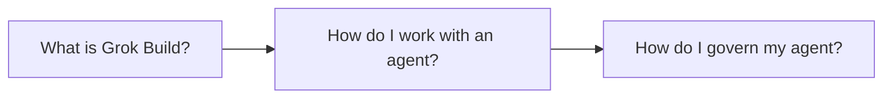
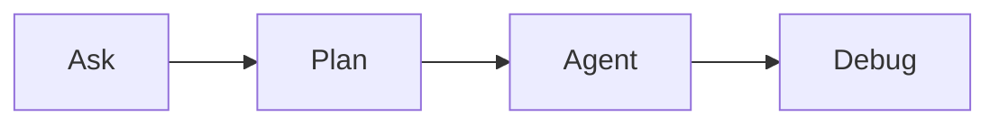

# Ledgerly design

Training fixture for **Adopting Grok Build for Design and Research**, the design and research companion to the Ledgerly Go app workshop ([devops-robxai/ledgerly-go](https://github.com/devops-robxai/ledgerly-go)) and the platform-engineering edition ([devops-robxai/ledgerly-platform](https://github.com/devops-robxai/ledgerly-platform)).

Fictional fintech. One small web UI: an account, a transactions list, a dispute. Sample data in the repo. Nothing in this repo calls a bank or a network API. There is no login.

The full check on this baseline is red on purpose. That is the design version of the failing test in the other Ledgerly repos. The session runs on each person's laptop. Cloud Agents are optional and not required.

Presenter script: [RUNBOOK.md](RUNBOOK.md).

## Start here

Run this before the session. It prints PASS, WARN, or FAIL, and a fix command for each miss.

```bash
npm run preflight
```

Windows, from the repo root:

```powershell
powershell -NoProfile -ExecutionPolicy Bypass -File .\scripts\preflight.ps1
```

The dev container uses `npm run preflight` too. `npm run ready` installs dependencies and then runs the same preflight, so one command answers whether you can start. Warnings do not fail the command. Docker is a warning. `make` is a warning when it is missing, because the npm scripts work without it.

Prerequisites:

- Grok Build, signed in
- git
- Node.js 20+ and npm (the [nodejs.org](https://nodejs.org/) installer is enough on macOS, Windows, and Linux)
- one networked `npm run ready`

Python is not required. Docker is optional (dev container only).

## The picture

Leave this picture up while you talk. Cursor and GitHub draw the diagrams below. The same diagrams are on the local runbook page, which also has a Copy button on every prompt. Start it with `npm run runbook` (Windows: `scripts/runbook.ps1`) and open http://127.0.0.1:43176/runbooks/101. Port 43176 stays clear of the app on 43175, the Go app on 43173, and the platform runbook on 43174.



The screen uses shared components and the tokens in `src/tokens.css`.



The session has the same three parts as the other 101s. Rules come last. Figma is last inside governance, and it is cut if you are over time or nobody has a Figma account.





## Before the session

First run needs network. It downloads the npm dependencies. After that, `npm run check`, `npm run dev`, and `npm run runbook` do not need network.

The readiness command should print `READY`. It does not run the design checks. On the demo baseline, the full check is still supposed to fail (tokens and accessibility).

### macOS (Intel and Apple Silicon)

Prerequisites: Git, and Node.js 20 or newer (`node` and `npm` on your PATH). Install Node from [nodejs.org](https://nodejs.org/) or with Homebrew (`brew install node`). You do not need Python.

```bash
npm run ready
```

`make ready` is the same command when `make` is installed.

### Windows (64-bit)

Prerequisites: [Git for Windows](https://git-scm.com/download/win) and [Node.js 20+](https://nodejs.org/). In the Node installer, leave **Add to PATH** enabled. You do not need make, bash, WSL, or Python. Windows on ARM is fine when Node publishes an arm64 build, which the current installer does. If Node will not run, use the dev container below.

From the repo root, in PowerShell:

```powershell
powershell -NoProfile -ExecutionPolicy Bypass -File .\scripts\ready.ps1
```

`npm run ready` is the same command in PowerShell, Command Prompt, or the Windows Terminal.

### Linux (amd64 and arm64)

Prerequisites: git, and Node.js 20+ (`node` and `npm` on your PATH). Install Node from [nodejs.org](https://nodejs.org/) or the distro packages when they are new enough. `make` is optional.

```bash
npm run ready
```

### Dev container (any OS, including Apple Silicon)

Prerequisites: Docker Desktop. The image is Ubuntu 24.04 and is published for amd64 and arm64, so an Apple Silicon Mac runs the arm64 container. Do not force `--platform=linux/amd64`. In Cursor, run **Dev Containers: Reopen in Container**. The container installs Node 22 and `make` if the image does not already have it, then runs `npm install`. Then, in the container terminal:

```bash
npm run ready
```

### Runbook page

Node only. The page does not download anything when it starts. Port **43176** stays clear of the app on **43175**.

macOS, Windows, and Linux:

```bash
npm run runbook
```

Windows PowerShell, from the repo root, if you prefer the script file:

```powershell
powershell -NoProfile -ExecutionPolicy Bypass -File .\scripts\runbook.ps1
```

Dev container: `npm run runbook`. Ports 43175 and 43176 are forwarded.

Open **http://127.0.0.1:43176/runbooks/101**. `/` redirects there. The page reads `RUNBOOK.md` and draws the diagrams with the Mermaid script stored in `web/static/`.

### App

```bash
npm run dev
```

Open **http://127.0.0.1:43175**. Account is `/`, transactions are `/transactions`, the sample dispute is `/disputes/dsp_1043`.

## Run

```bash
npm run ready       # install dependencies, then preflight
npm run preflight   # PASS/WARN/FAIL before the session
npm run check       # eslint, typecheck, tokens, accessibility
npm run dev         # app at http://127.0.0.1:43175
npm run runbook     # local runbook page at http://127.0.0.1:43176/runbooks/101
npm run demo-reset  # restore planted files from the demo-baseline tag
```

`make ready`, `make check`, `make dev`, `make runbook`, and `make demo-reset` call the same Node scripts.

Windows equivalents, from the repo root:

```powershell
powershell -NoProfile -ExecutionPolicy Bypass -File .\scripts\ready.ps1
powershell -NoProfile -ExecutionPolicy Bypass -File .\scripts\check.ps1
powershell -NoProfile -ExecutionPolicy Bypass -File .\scripts\preflight.ps1
powershell -NoProfile -ExecutionPolicy Bypass -File .\scripts\demo-reset.ps1
powershell -NoProfile -ExecutionPolicy Bypass -File .\scripts\runbook.ps1
```

`npm run dev` is the same on Windows as on macOS and Linux.

On this baseline, `npm run check` fails on tokens and accessibility. eslint and typecheck pass. Do not "fix" the baseline on `main`. The Debug beat does that live, on a branch.

`.cursor/environment.json` is optional. It only matters for a Cursor account that uses Cloud Agents. The workshop does not.

## Planted findings

These stay on the demo baseline (`demo-baseline` tag). Do not clean them up on `main`. The agent cannot see this file or `RUNBOOK.md` during the demo (`.cursorignore`). The check output names the files. That is what the presenter pastes into Debug.

| Finding | Where | What catches it |
| --- | --- | --- |
| Hard-coded hex colours on the dispute callout (`#e7f0ff`, `#12305c`, `#1a56db`) | `src/screens/DisputeDetail.tsx` | token check |
| Spacing off the scale (`18px`, `20px`, `10px` on `.account-hero`) | `src/styles.css` | token check |
| Icon-only copy button with no accessible name | `src/screens/DisputeDetail.tsx` | accessibility check |
| "In review" badge, `#e6c200` on `#fff4cc`, about 1.6:1 | `.badge-review` in `src/styles.css`, tokens `--color-review-fg` and `--color-review-bg` | accessibility check (WCAG AA 4.5:1) |

eslint (including jsx-a11y recommended) and `tsc` pass on the baseline. The icon button is a `<button>` whose accessible name is empty, which the accessibility script reports. The contrast pair lives in the token file on purpose: the values are tokens, and they still fail AA.

A fix that turns the check green uses tokens for the callout, spacing tokens on `.account-hero`, an `aria-label` (or visible text) on the icon button, and review colours that clear 4.5:1. Do not weaken the scripts.

## Layout

```
src/tokens.css              colour, spacing, type, radius
src/components/             Button, Card, Badge, Table, EmptyState
src/screens/                Account, Transactions, Dispute
src/data.ts                 fictional sample rows
research/notes/             P1–P6 interview notes (fictional)
research/survey.csv         short survey
.cursor/rules/              empty on the baseline; governance adds a project rule
.cursor/skills/             absent on the baseline; governance adds a project skill
.cursorignore               hides RUNBOOK.md and README.md from the agent
reference/cursor-mcp.json.example
                            Figma MCP config the project-scope prompt can read
scripts/workshop.mjs        preflight, ready, check, demo-reset
scripts/runbook.mjs         local runbook page
scripts/*.ps1               Windows entry points
web/static/                 page styles and vendored Mermaid
```

The status filter and the helper line under the dispute status are not in the tree. The demo adds them.

## Reset

```bash
npm run demo-reset
```

```powershell
powershell -NoProfile -ExecutionPolicy Bypass -File .\scripts\demo-reset.ps1
```

That restores the planted files from the `demo-baseline` tag (or `origin/main` if the tag is not there), deletes project rules under `.cursor/rules/`, deletes project skills under `.cursor/skills/` and `.agents/`, and deletes a demo `AGENTS.md` plus `.cursor/mcp.json` in this repo root. It does not change `RUNBOOK.md`. It does not remove `~/.cursor/mcp.json` or a personal user rule. It does not commit.

The tag `demo-baseline` points at the fixture commit that contains these planted findings. `npm run demo-reset` checks that tag out for the app files only.
