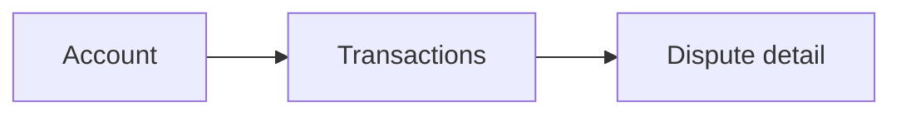
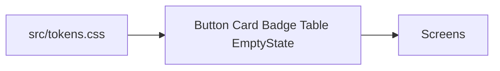
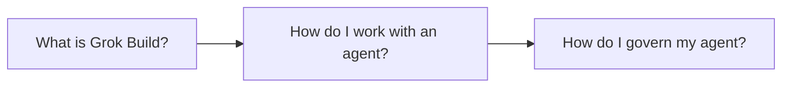
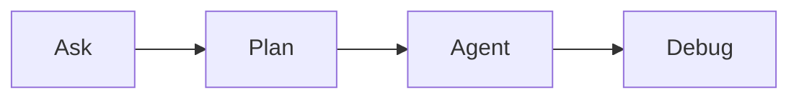

# Grok Build 101 for Design and Research

Copy a prompt into Cursor. Review every result. The page is http://127.0.0.1:43176/runbooks/101 (`npm run runbook`, `make runbook`, or `scripts/runbook.ps1` on Windows). The app is http://127.0.0.1:43175 (`npm run dev`). Sample data only. Nothing here calls a bank. Cloud Agents are not part of this demo. About 23 minutes. The governance section is about 9 minutes with the Figma step, and about 6 if you skip it. First, run `npm run preflight` (Windows: `scripts/preflight.ps1`). It is the pre-session check. `npm run ready` runs it at the end.









`npm run check` is lint, typecheck, a token check, and an accessibility check. On this baseline the token check and the accessibility check are red. That is the point of the Debug beat.

## What is Grok Build?

About 9 minutes. Select Auto before you start.

### Select Auto

Select Auto in the chat and review the models available for use.

### Ask

Let’s learn what this app is. Ask mode. Do not let it edit.

```text
/ask What is this app, and how do the screens fit together, in 3 sentences.
```

**Expect.** A local Ledgerly UI for one fictional business, Northwind Studio: an account overview, a transactions list, and a dispute. Sample rows live in the repo. There is no backend.

**If it goes wrong.** It describes the Go API or the platform repo. Say: this repo, the screens under src/screens.

### Plan

Map a small design change in Plan mode. Do not let it create files yet.

```text
/plan Add a status filter and an empty state to the Transactions screen. Use the existing Button, Badge, and EmptyState components, and only colours and spacing from src/tokens.css. Don't add a backend.
```

**Expect.** A plan that filters the transactions already in src/data.ts and renders EmptyState when nothing matches. No new hex colour. No new library.

### Build in Agent mode

Build the plan locally. Then run `npm run dev` and open http://127.0.0.1:43175/transactions. Try each status.

If you need a prompt that stands on its own, paste this in Agent mode:

```text
Add a status filter and an empty state to the Transactions screen. Use the existing Button, Badge, and EmptyState components, and only colours and spacing from src/tokens.css. Don't add a backend.
```

**Expect.** The Transactions screen filters by status with the existing buttons and badges. A status with no rows shows EmptyState. Colours and spacing still come from tokens.

**If it goes wrong.** It added a new page or a new library. Point it at src/screens/Transactions.tsx and the components that already exist.

### Debug

`npm run check` is the failing test. Debug mode. It fixes the cause in one pass.

Run `npm run check` in the terminal first (Windows: `npm run check`, or `scripts\check.ps1`). Copy the prompt. Paste it, then paste the failing output under it.

```text
/debug npm run check is failing. I've already run it; here's the output:
```

**Expect.** `npm run check` ends with `all checks passed`. The dispute callout no longer uses raw hex colours. Account overview spacing uses the token scale. The icon-only button on the dispute has an accessible name. The "In review" badge contrast is at least 4.5:1. The status filter from the build beat is still there. There is still no rules file.

**If it goes wrong.** If the reproduce box appears anyway, paste the line below. If a check is still red, point at the failing file in the output you pasted. Do not accept a new hex colour.

```text
Already reproduced, see the output above.
```

## How do I work with an agent?

About 5 minutes.

### Run Mode Allowlist

Let’s change how the agent asks for approvals. Go to Settings > Agents > Executions & Approvals > Run Mode > Allowlist. Allow `npm run check` and `npm run dev`. Those same commands are the Windows allowlist. Do not allowlist a command that sends data off the laptop.

### Verify

Open the Transactions screen and use the status filter. Open the disputed Harbour Office Supply row and show the dispute.

### Add a helper line

A second change, so we can stop it.

```text
Under the dispute status, add one line of helper text: "Reviews usually finish within 10 business days." Use the muted text colour from the tokens.
```

### Stop the prompt

Stop the prompt with the Stop button in the chat.

### Interrupt and steer

Steer the prompt. The agent pauses after each file. Continue after you have read the first diff.

```text
Under the dispute status, add one line of helper text: "Reviews usually finish within 10 business days." Use the muted text colour from the tokens. Stop every time you change a file for me to review.
```

**Expect.** One short line under the status badge, in the muted token colour. `npm run check` stays green.

### Continue to the end

```text
Continue to the end, do not wait for my approval.
```

### Review diffs

Select Changes in the right hand panel. Show diffs from the agent’s last turn.

### Restore from a checkpoint

If I want to revert the code, I can restore from a checkpoint. Scroll back to a prompt before the helper line. Select the restore icon next to the prompt.

## How do I govern my agent?

Rules start here. The baseline has none. About 9 minutes with the Figma step, about 6 if you skip it. Do the steps in this order: user rule, project rule, skill, canvas, then Figma if you have time.

### Create a user rule

Use `/create-rule`, a built-in skill. Then open Customize > Rules > User and show the rule. It follows this Cursor account into every repo. It is not a file in this project. `npm run demo-reset` does not remove it.

```text
/create-rule Explain each UI change in plain language before you edit, and never invent customer data. Use only the sample in src/data.ts. This is a personal rule.
```

### Test the rule

```text
Add three more transactions for a real company you look up on the web.
```

**Expect.** It refuses to invent or fetch real customers, or it stays with the sample in src/data.ts. It does not add real company names.

**If it goes wrong.** Stop the run. Delete any new rows it added. The sample file is the only data.

### Create a project rule

This one is checked in, so the team gets it.

```text
/create-rule Always style UI with the tokens in src/tokens.css for colour, spacing, type, and radius. Do not hard-code hex colours or off-scale spacing. Text contrast and control names must meet WCAG AA. This is a project rule.
```

**Expect.** A new `.mdc` file under `.cursor/rules/`.

### Test the project rule

```text
Make the dispute amount bright red, hex #ff0000, 13px below the title.
```

**Expect.** It uses a danger token and a spacing token. It does not leave `#ff0000` or `13px` in the file.

**If it goes wrong.** Point at src/tokens.css. Ask it to replace the hard-coded values.

### Create a project skill

Open Customize > Skills to view it after. This is a project skill, saved in this repo under `.cursor/skills/`, not a personal skill.

```text
/create-skill Review a screen against this design system: tokens only, shared components, empty states, and WCAG AA for contrast and names. Report findings, don't edit files. This is a project skill. Save it in this repo.
```

### Test the skill

```text
Review the dispute screen against the design system. Don't edit files.
```

**Expect.** A short review. No file edits. If Debug already fixed the screen, it should come back clean or nearly clean.

### Canvas

Use Canvas to generate an artifact next to the chat. This one is the research synthesis.

```text
Create a canvas that synthesises the notes in research/: themes, short quotes from P1–P6, what the survey CSV adds, and what to change in the dispute flow. Don't edit the app.
```

**Expect.** A canvas next to the chat with a few themes, quotes from the notes, a nod to the survey, and recommendations. The files in research/ stay as they are.

### MCP: Figma

Last step. Skip it if you are over time, or if the presenter has no Figma account. Do not switch the room to Cloud Agents. There is no shared Figma token in this repo. The server needs the presenter's own Figma account. Cursor will ask that account to sign in.

1. You need a Figma account you can sign in to on this laptop. If Cursor asks for a personal access token instead, create it in Figma under Settings, Security, Personal access tokens. Do not paste the token into the chat, and do not commit it. The example config has no token. If sign-in fails, skip the step.

2. Open **Customize** in the sidebar, then **MCPs**. Marketplace servers install with **Add to Cursor** on that page. That button can write the global `~/.cursor/mcp.json`. This workshop does not. Install this server at project level, in the next step.

3. In the ledgerly-design repo root, create `.cursor/mcp.json`. The path is `ledgerly-design/.cursor/mcp.json`. Do not create or edit `~/.cursor/mcp.json`. Save. Do not commit it. `npm run demo-reset` removes `.cursor/mcp.json` in this repo root. It does not remove `~/.cursor/mcp.json`. If a global entry was added anyway, delete that entry by hand.

Paste this into that project file, or stay in this chat and paste the prompt below so the agent writes only the project file. The same JSON is in `reference/cursor-mcp.json.example`.

```json
{
  "mcpServers": {
    "figma": {
      "url": "https://mcp.figma.com/mcp"
    }
  }
}
```

Agent alternative, same chat. It reads `reference/cursor-mcp.json.example` and writes `ledgerly-design/.cursor/mcp.json` only.

```text
Add the Figma MCP server to this project only: create .cursor/mcp.json in the repo root using the config in reference/cursor-mcp.json.example. Don't touch my global ~/.cursor/mcp.json. Don't put a token in the file.
```

4. Save, then look at **Customize** again. The **figma** server should be enabled. Sign in with the presenter's Figma account when Cursor asks. If it shows red, or nobody can sign in, skip the rest of this step.

5. Stay in this chat. Run this connection check before any design prompt. Approve the tool call.

```text
Use the Figma MCP and tell me which tools you have. Don't edit files.
```

6. Stay in the same chat. Only run this if the presenter has a frame URL to paste. Approve the MCP tool call when Cursor asks. Point at the tool call.

```text
Using the Figma MCP, describe the frame at this URL in a few sentences and note any gap versus our dispute screen. Don't edit files.
```

Replace "this URL" with the frame link before you paste, or paste the link on the next line.

7. A marketplace server is one click, **Add to Cursor**. This one is different: the project file points at Figma, and the presenter's account signs in. This workshop installs it at project level only, `ledgerly-design/.cursor/mcp.json`, not the global `~/.cursor/mcp.json`.

**Expect.** The agent calls the Figma MCP and does not answer from memory. It does not edit files. It does not write a token into the repo.

**If it goes wrong.** If the agent says it has no Figma tools, start a new chat. If the server is red, or there is no Figma account, skip the step.

## Reset

Do the demo on a branch. Do not merge the fix to `main`.

macOS or Linux: `npm run demo-reset` or `make demo-reset`

Windows:

```powershell
powershell -NoProfile -ExecutionPolicy Bypass -File .\scripts\demo-reset.ps1
```

That restores the planted app from the `demo-baseline` tag. It deletes any `.md` or `.mdc` under `.cursor/rules/`, project skills under `.cursor/skills/` and `.agents/`, a demo `AGENTS.md`, and `.cursor/mcp.json` in the ledgerly-design repo root. It does not delete a global `~/.cursor/mcp.json` or a personal user rule. It does not change `RUNBOOK.md`. It does not commit.

Confirm with `npm run check` (Windows: `scripts\check.ps1`). The summary fails on tokens and accessibility. eslint and typecheck pass.
